# Namco 2x Systems: Namco System 21 / 22 / 23 games for PC

Namco arcade games from the 1990s, rebuilt so they run on a normal
computer. You need your own copy of each game's files (the MAME versions);
they are not included here. A ROM set from **MAME 0.271 or later** is
supported; the chip unpacker also accepts a few older chip-name spellings
where a MAME set has since renamed one (see [docs/ROM_CHECKSUMS.md](docs/ROM_CHECKSUMS.md)).

### System 22 / Super System 22

| Game | Year | Status | Online play | Game files you need | Linux | Windows |
|---|---|---|---|---|---|---|
| **Prop Cycle** | 1996 | Playable, start to finish | no | `propcycl.zip` | yes | yes |
| **Rave Racer** | 1995 | Playable | **yes**, up to 8 ([how](#playing-online)) | `raverace.zip` + `namcoc74.zip` | yes | yes |
| **Tokyo Wars** | 1996 | Playable | no | `tokyowar.zip` | yes | yes |
| **Dirt Dash** | 1995 | Playable, all five stages; optional no time limit | no | `dirtdash.zip` | yes | yes |
| **Armadillo Racing** | 1997 | Playable; the mouse or a USB trackball is the trackball | no | `adillor.zip` | yes | yes |
| **Time Crisis** | 1995 | Playable; mouse or light gun | no | `timecris.zip` | yes | yes |
| **Ace Driver** | 1994 | Playable; force feedback, developer screens | no | `acedrive.zip` + `namcoc74.zip` | yes | yes |
| **Cyber Commando** | 1994 | Playable; Japanese version | no | `cybrcomm.zip` + `namcoc74.zip` | yes | yes |
| **Ridge Racer 2** | 1994 | Playable; widescreen, developer screens | no | `ridgera2.zip` + `namcoc74.zip` | yes | yes |

### System 21

| Game | Year | Status | Online play | Game files you need | Linux | Windows |
|---|---|---|---|---|---|---|
| **Cyber Sled** | 1993 | Playable; developer test mode, widescreen with the HUD at the edges | **yes**, 2 players ([how](#playing-online)) | `cybsled.zip` + `namcoc67.zip` + `namcoc68.zip` | yes | yes |

### System 23

| Game | Year | Status | Online play | Game files you need | Linux | Windows |
|---|---|---|---|---|---|---|
| **Time Crisis II** | 1997 | Playable; mouse or light gun, gun recoil output, play either character ([its own README](tc2/README.md)) | **yes**, 2 players, LINK PLAY ([how](#playing-online)) | `timecrs2.zip` | yes | yes |
| **Crisis Zone** | 1999 | Playable; mouse or light gun, gun recoil output ([its own README](crszone/README.md)) | no | `crszone.zip` | yes | yes |
| **Angler King** | 1998 | Playable (Super System 23); English subtitles, a working reel, depth fog ([its own README](aking/README.md)) | no | `aking.zip` | yes | yes |

**Are you running the same ROMs as the authors?** The checksums of every ROM file the games use are in
[docs/ROM_CHECKSUMS.md](docs/ROM_CHECKSUMS.md), with a list in `md5sum` format for each game.

**No extra BIOS file.** Earlier instructions asked for `c71.bin` or MAME's `namcoc71.zip` (the DSP's BIOS). The games have it built in now, so you never need it; if you have it, ignore it.

## Pictures

Tokyo Wars:

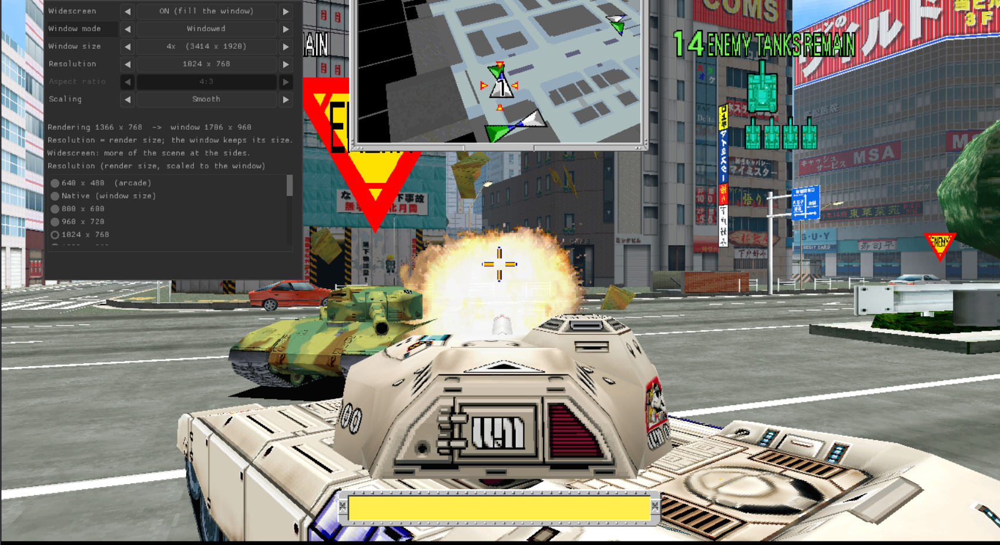

Rave Racer:

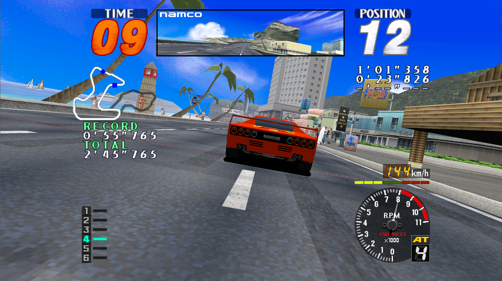

Time Crisis:


Dirt Dash:


Ace Driver:

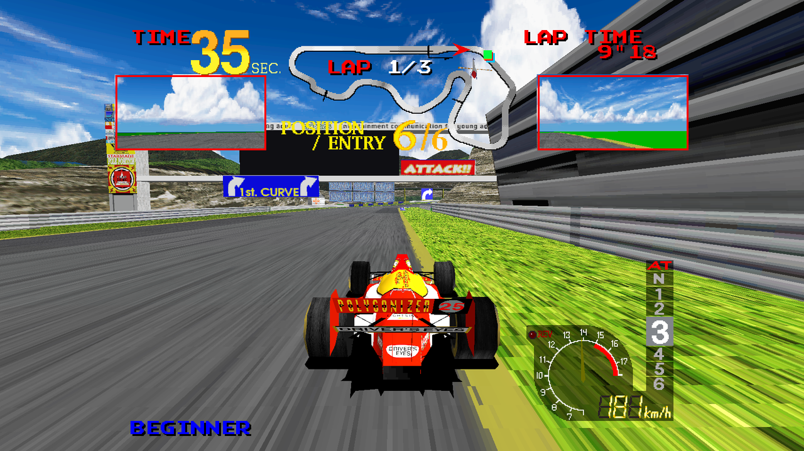

Cyber Commando:

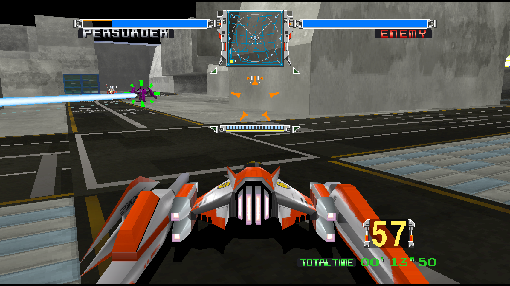

Ridge Racer 2:

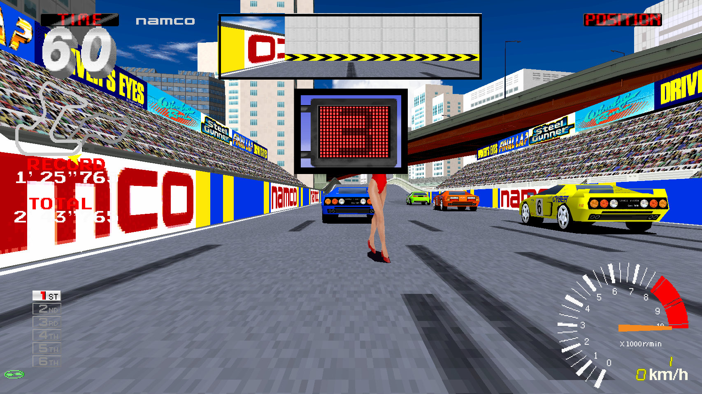

Cyber Sled:

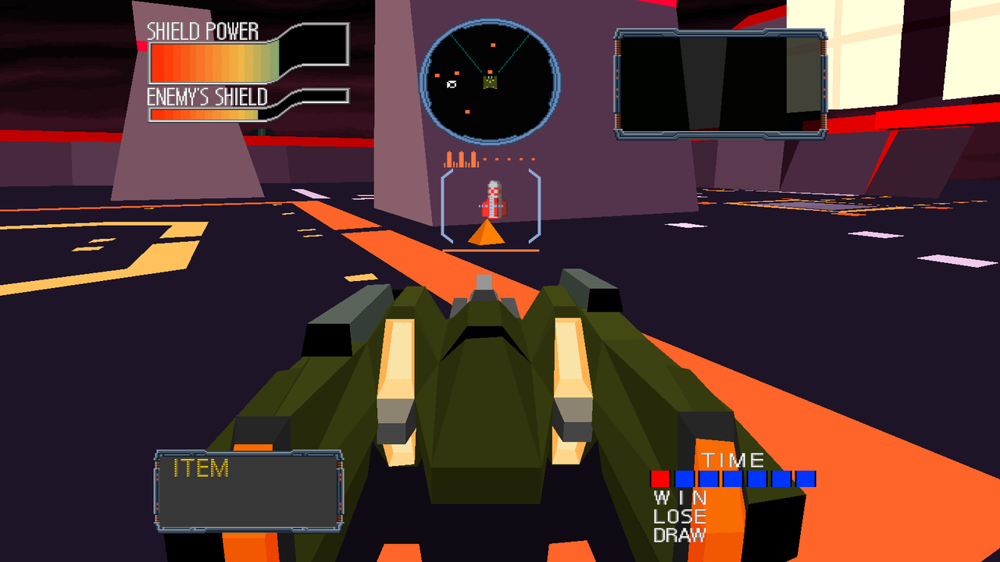

Time Crisis II:

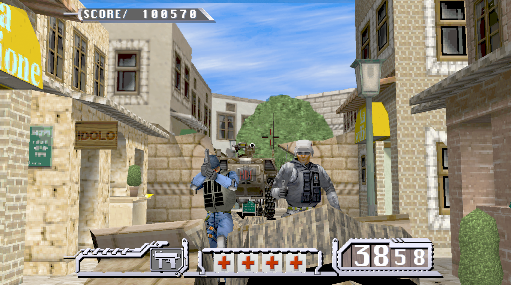

Angler King:

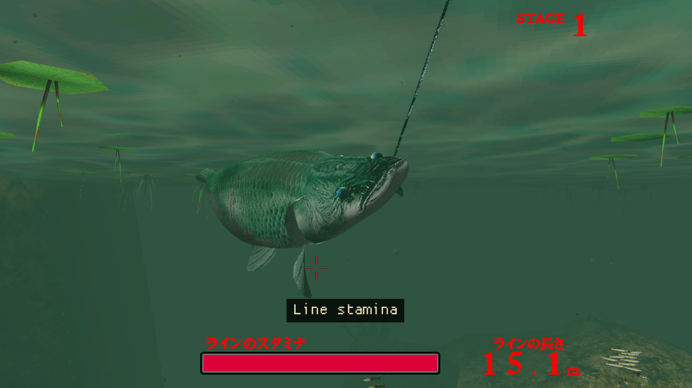

Prop Cycle:

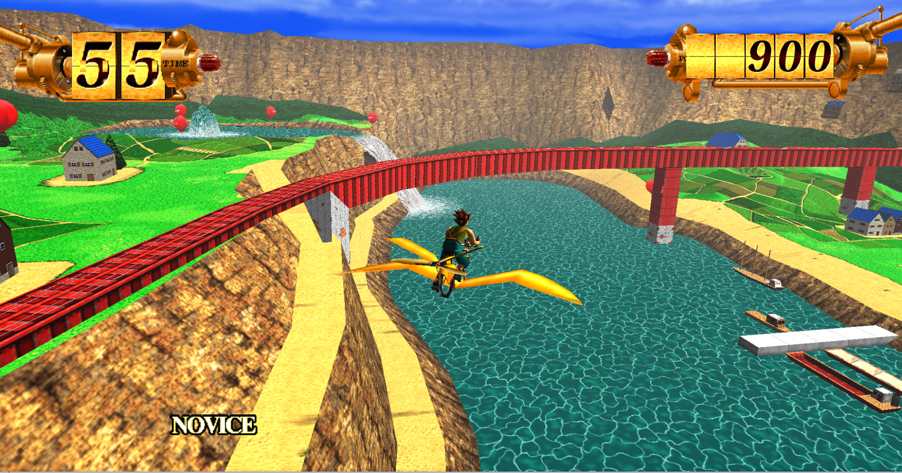
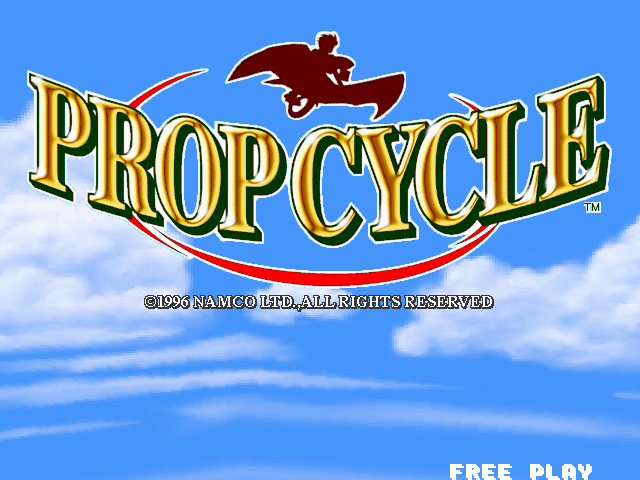

Tokyo Wars, the title screen:

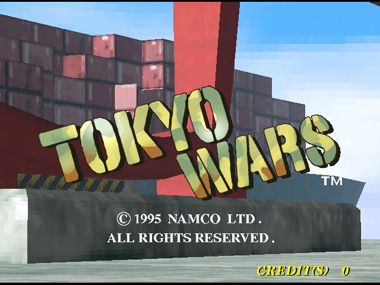

## Download (nothing to build)

Each release on the [Releases page](https://github.com/spacestate1/namco22-decompile/releases) has ready-made packages.
**None of them contains game files**: after installing, you put your own zips in a folder (the `INSTALL.txt` next to the packages says where).

| Package | For | How to install |
|---|---|---|
| `namco-2x-systems_VERSION_amd64.deb` | Ubuntu 22.04 or newer, Linux Mint 21 or newer, LMDE 6, Debian 12 or newer | `sudo apt install ./namco-2x-systems_*_amd64.deb` |
| `PropCycle-x86_64.AppImage`, `RaveRacer-...`, `TokyoWars-...`, `DirtDash-...`, `ArmadilloRacing-...`, `TimeCrisis-...`, `AceDriver-...`, `CyberCommando-...`, `RidgeRacer2-...`, `CyberSled-...`, `TimeCrisis2-...`, `CrisisZone-...`, `AnglerKing-...` | **The Steam Deck**, and any 64-bit Linux without installing anything | `chmod +x` the file and run it (on a Deck: Desktop Mode, right-click it > Add to Steam) |
| `windows-release-VERSION.zip` | Windows 10 or 11, 64-bit | Unzip it anywhere, put the game zips in its `roms` folder, double-click the game's `.exe` |

On Linux, start a game from the applications menu (or type `propcycle`, `raveracer`, `tokyowars`, `dirtdash`, `armadilloracing`, `timecrisis`, `acedriver`, `cybercommando`, `ridgeracer2`, `cybersled`, `timecrisis2`, `crisiszone` or `anglerking`). The first time, it makes the folder
`~/.local/share/namco-2x-systems/<game>/roms`, tells you which zip is missing and copies any it finds in `~/Downloads`. To uninstall: `sudo apt remove namco-2x-systems`
your game files, settings and scores stay in `~/.local/share/namco-2x-systems/`.
**Upgrading from 0.6 or older:** the package was called `namco22`; the new one replaces it, and the games keep using your old
`~/.local/share/namco22/<game>/` folders (and `namco22-data` portable folders), so nothing has to be moved.

**Steam Deck:** download the AppImage of each game you want, put your ROM zips in `~/.local/share/namco-2x-systems/<game>/roms/` (Desktop Mode: Dolphin > Ctrl+H shows the
hidden `.local` folder; zips in `~/Downloads` are found automatically), then in Desktop Mode right-click the AppImage > *Add to Steam* (or Steam >
*Add a Non-Steam Game*) and start it from Game Mode. The AppImages use the Deck's own SDL2, so Steam Input works: the menu opens with **R3** or by holding
**Start** for a second. Each AppImage uses the same folders as the `.deb`, so the ROMs and settings are shared. If an AppImage will not start, run it from a
terminal (`./DirtDash-x86_64.AppImage`) and read the message; on a system without FUSE, `--appimage-extract-and-run` works.

The AppImage names carry no version number, so **updating is overwriting the file** and a Steam shortcut keeps working. ROM zips placed **next to the
AppImage** (or in a `roms` folder beside it) are found too. **Portable mode:** make a folder named `namco-2x-systems-data` next to the AppImages and each game
keeps everything there (`namco-2x-systems-data/<game>/`: its roms, the unpacked chips, settings, scores and recordings) instead of `~/.local/share/namco-2x-systems` --
one disk, e.g. a microSD card, then works the same on a Steam Deck and another PC. The AppImage standard's own portable folder works too: a folder
named after the AppImage plus `.home` (`TimeCrisis-x86_64.AppImage.home`, or `TimeCrisis-x86_64.home`) keeps that game's data inside it. The Windows zip
is portable already (everything lives in its folder).

Once extracted by the app after a first run, ROM zips are no longer needed and can be removed.

## How it was made

Each game's original program was taken apart with
[Ghidra](https://ghidra-sre.org/) (the NSA's free reverse-engineering tool)
and checked, piece by piece, against the arcade machine running in
[MAME](https://www.mamedev.org/).

- **Prop Cycle**: Ghidra's output was turned into C and fixed by hand.
- **Rave Racer**: the program is translated to C by a tool of this project
  (`raverace/gen/rr_lifted.c` is its output), and parts are being rewritten
  by hand.
- **Tokyo Wars**: the program is translated to C by the same tool
  (`tokyowar/gen/tw_lifted.c`); its master DSP and sound programs are
  turned into C when you build, from your own copy of the game files.
- **Dirt Dash**: the program is translated to C by the same tool
  (`dirtdash/gen/dd_lifted.c`); its master DSP and sound programs are
  turned into C when you build, from your own copy of the game files.
- **Armadillo Racing**: the program is translated to C by the same tool
  (`adillor/gen/am_lifted_NN.c`, 16 parts) and matches MAME instruction for
  instruction through the attract; its master DSP and sound programs are turned
  into C when you build (the sound notes match MAME's).
- **Time Crisis**: the program is translated to C by the same tool
  (`timecris/gen/tc_lifted_NN.c`, 16 parts); its master DSP and sound programs are
  turned into C when you build, from your own copy of the game files.
  It is the newest game here: the program's code was checked against MAME's
  own coverage of the real game, and the DSP and sound translations against
  the interpreters they were made from; it has **not yet been compared with MAME
  frame by frame or note by note**, so expect small differences.
- **Ace Driver**: the same board as Rave Racer, so it runs on Rave Racer's code with one table of its
  own (`acedriver/src/ad_game.c`); its program is translated by the same tool (`acedriver/gen/rr_lifted.c`),
  its master DSP and sound programs are turned into C when you build. Both translations were checked against
  the interpreters they were made from; the picture was checked against MAME's on MAME's own video state.
  The **Debug** page of its menu launches six developer screens the shipped game never reaches (object, sprite
  and character viewers, a results-screen test); they run while the test switch is on (F2 leaves).
- **Cyber Commando**: the Rave Racer board again, one table (`cybrcomm/src/cc_game.c`) plus a twin-stick mode in the shared
  code; its program (`cybrcomm/gen/rr_lifted.c`) was checked instruction by instruction against MAME over a whole played game
  (162 million instructions), and its DSP and sound translations against the interpreters they were made from.
- **Ridge Racer 2**: the Rave Racer board again, one table (`ridgera2/src/r2_game.c`); its program (`ridgera2/gen/rr_lifted.c`) was
  checked instruction by instruction against MAME over the first 300 attract frames, and its DSP and sound translations against the
  interpreters they were made from (attract, a race and the test-mode pages, byte-identical). The **Debug** page of its menu launches
  the developer menu left in the game (SELECT MODE: object viewer, colour bars, switch / RAM / area / sound tests) and the hidden
  ADJUSTMENT screen. Force feedback and link play are not done yet.
- **Cyber Sled**: a Namco **System 21** board (two 68000s, five C67 DSPs for the 3D, a 6809 sound CPU, a C68 I/O controller).
  Both 68000 programs are translated by the same tool (`cybsled/gen/cm_lifted.c`, `cs_lifted.c`) and were checked
  instruction by instruction against MAME's; the five DSP programs, the sound program and the I/O program are turned into
  C when you build, each checked against the interpreter it was made from. The sound chip (YM2151) is this project's own
  code. Online play links two cabinets the way the arcade's own cable did.
- **Time Crisis II**: a Namco **System 23** board (a MIPS main CPU, an H8 sound / sub CPU, an H8 on the gun I/O board). The MIPS
  program is translated to C (`tc2/gen/tc2_lifted_*.c`) and was checked instruction by instruction against MAME's; the two H8
  programs are turned into C when you build. The 3D chips, the text layer, the C352 sound chip and the JVS link are its own code
  (`tc2/`, a self-contained tree: see [tc2/README.md](tc2/README.md)).
- **Crisis Zone**: a Namco **System 23 Evolution 2** board, run on the same System 23 code as Time Crisis II. Its MIPS program is
  translated to C the same way (`crszone/gen/crszone_lifted_*.c`) and its two H8 programs are turned into C when you build
  (`crszone/`: see [crszone/README.md](crszone/README.md)).
- **Angler King**: a Namco **Super System 23** board, on the same System 23 code again. Its MIPS program is translated to C
  (`aking/gen/aking_lifted_*.c`), its two H8 programs (the sub CPU and the FCA-1 I/O board that reads the rod and reel) are turned
  into C when you build (`aking/`: see [aking/README.md](aking/README.md)).
- The sound programs of all the games are turned into C when you build,
  from your own copy of the game files.

This repository has **only the code**. It has no game files and no Ghidra
project or tools. Everything the games show or play is read from your own
zips.

## What you need to build it yourself

- **Your own copy of each game's zip** (see the table at the top). They are needed while building, not only while playing: each game's sound program
  and DSP program is turned into C from them.
- **Linux (64-bit):** a C compiler (`gcc`), `make`, CMake, `pkg-config`, the SDL2, OpenGL (Mesa) and zlib development files, and Python 3 with numpy.
  `./install-deps.sh` installs all of these on Debian / Ubuntu, Fedora, Arch, openSUSE, Alpine, Void and Gentoo.
- **Windows programs** are built from Linux (`./build-windows.sh`): the MinGW-w64 cross compiler (`x86_64-w64-mingw32-gcc`), CMake, `make`, `curl`, `7z` (p7zip)
  and Python 3. The first run downloads SDL2, zlib and Mesa (the fallback OpenGL for computers with no graphics driver), so it needs the internet.
- **Building the `.deb`, AppImages and Windows zip the way a release is made** is done by the author with a script that is not part of this repository (it needs
  Podman for the Ubuntu container); you do not need it to build or play.

## Linux

Open a terminal in this folder. First, once:

```bash
./install-deps.sh
```

This installs the tools the games need. It asks for your password.

Then build each game you have. Change the paths if your zips are
somewhere else:

```bash
./build.sh ~/Downloads/propcycl.zip                                       # Prop Cycle
raverace/build.sh ~/Downloads/raverace.zip ~/Downloads/namcoc74.zip        # Rave Racer
tokyowar/build.sh ~/Downloads/tokyowar.zip                                 # Tokyo Wars
dirtdash/build.sh ~/Downloads/dirtdash.zip                                 # Dirt Dash
adillor/build.sh ~/Downloads/adillor.zip                                   # Armadillo Racing
timecris/build.sh ~/Downloads/timecris.zip                                 # Time Crisis
acedriver/build.sh ~/Downloads/acedrive.zip ~/Downloads/namcoc74.zip       # Ace Driver
cybrcomm/build.sh ~/Downloads/cybrcomm.zip ~/Downloads/namcoc74.zip        # Cyber Commando
ridgera2/build.sh ~/Downloads/ridgera2.zip ~/Downloads/namcoc74.zip        # Ridge Racer 2
cybsled/build.sh ~/Downloads/cybsled.zip ~/Downloads/namcoc67.zip ~/Downloads/namcoc68.zip   # Cyber Sled
tc2/build.sh ~/Downloads/timecrs2.zip                                                    # Time Crisis 2 (then tc2/launch.sh)
crszone/build.sh ~/Downloads/crszone.zip                                                 # Crisis Zone (then crszone/launch.sh)
aking/build.sh ~/Downloads/aking.zip                                                     # Angler King (then aking/launch.sh)
```

Rave Racer's, Tokyo Wars', Dirt Dash's, Armadillo Racing's, Time Crisis', Ace Driver's, Cyber Commando's, Ridge Racer 2's and Cyber Sled's first builds take a few minutes
(Cyber Commando's needs about 4.5 GB of free memory; give Ridge Racer 2 the same, or build it with `JOBS=1`).

Then play:

```bash
./launch.sh prop      # Prop Cycle
./launch.sh rave      # Rave Racer
./launch.sh tokyo     # Tokyo Wars
./launch.sh dirt      # Dirt Dash (`./launch.sh dirt jungle` starts in a stage: city, jungle, hill, mountain, snow)
./launch.sh armadillo # Armadillo Racing (the mouse is the trackball)
./launch.sh tc        # Time Crisis (the mouse is the gun)
./launch.sh ad        # Ace Driver
./launch.sh cc        # Cyber Commando
./launch.sh r2        # Ridge Racer 2
./launch.sh cs        # Cyber Sled
./launch.sh           # the list of games and options
```

## Windows

All the games run on Windows. The Windows version is built from Linux. Type:

```bash
./build-windows.sh
```

This makes a `windows-release` folder. Copy it to the Windows computer.
Put the game files in its `roms` folder: `propcycl.zip` for Prop Cycle,
`raverace.zip` and `namcoc74.zip` for Rave Racer, `tokyowar.zip` for Tokyo
Wars, `dirtdash.zip` for Dirt Dash, `adillor.zip` for Armadillo Racing, `timecris.zip` for Time Crisis, `acedrive.zip` and `namcoc74.zip` for Ace Driver, `cybrcomm.zip` and `namcoc74.zip` for Cyber Commando, `ridgera2.zip` and `namcoc74.zip` for Ridge Racer 2, `cybsled.zip`, `namcoc67.zip` and `namcoc68.zip` for Cyber Sled, `timecrs2.zip` for Time Crisis II, `crszone.zip` for Crisis Zone, `aking.zip` for Angler King.
Then double-click **PropCycle.exe**, **RaveRacer.exe**, **TokyoWars.exe**, **DirtDash.exe**, **ArmadilloRacing.exe**, **TimeCrisis.exe**, **AceDriver.exe**, **CyberCommando.exe**, **RidgeRacer2.exe**, **CyberSled.exe**, **TimeCrisis2.exe**, **CrisisZone.exe** or **AnglerKing.exe**.

Building on Windows itself, and what in the code is there for Windows only:
[docs/WINDOWS.md](docs/WINDOWS.md).

## How to play

**Prop Cycle.** You fly a pedal-powered glider and pop balloons.

| Key | What it does |
|---|---|
| `5` | Put in a coin |
| `Enter` | Start |
| Arrow keys | Steer and tilt |
| `Space` | Pedal |
| `Esc` | Menu (restart, exit, sound, levels, screen) |
| `P` | Pause. While paused, the arrow keys turn the camera around the rider and `+` / `-` zoom |
| `F12` | Take a picture |

**Rave Racer.** A street race against the clock.

| Key | What it does |
|---|---|
| `5` | Put in a coin |
| `X` (or Up) | Gas |
| `Z` (or Down) | Brake |
| Left / Right | Steer |
| `A` / `S` | Shift down / up |
| `V` | Change the view |
| `F2` | Test mode on / off (press again to leave it) |
| `9` | Service |
| `P` | Pause |
| `Esc` | Menu |
| `F12` | Take a picture |

<a id="playing-online"></a>**Playing online (Rave Racer, Cyber Sled, Time Crisis II).** Up to eight players can race together in Rave Racer
(two in Cyber Sled and Time Crisis II: the arcade linked two cabinets -- in Time Crisis II the two of you play LINK PLAY together,
the first player as Richard (Left / Red), the second as Keith (Right / Blue)), each on
their own computer. Open the menu with `Esc` and go to the **Online** page,
then **Host / join a game...**:

- **Local LAN**: one player picks *Host a LAN game*; everyone else picks *Find
  LAN games* and clicks the game it finds.
- **Internet game**: type the address of a server (`host` or `host:port`, UDP
  27750 by default) and *Connect*. Anyone can run such a server on a machine
  that is always on: `server/` (`nmn-server`) is a small Rust program for exactly
  this, one server for every game's online play (see its README; the wire
  protocol is `docs/NETPLAY.md`). It still accepts older Rave Racer releases.

Everyone in the lobby then picks **Ready**, and anyone can start the race once
all players are ready. When the race begins the game turns free play on for
you and gives everyone a moment to step on the gas; choose your car and wait
for the others at the course select. Your name on the Online page is what the
other players see. Chat in the lobby stays on the server for a while: whoever joins later sees the game's last 50 lines.

**Playing the other side alone (Time Crisis II).** *Esc > Cabinet* picks which of the two linked cabinets your machine is:
Left / Red plays as Richard, Right / Blue as Keith. It takes effect from the next game.

**Tokyo Wars.** You command a tank in a city battle.

| Key | What it does |
|---|---|
| `5` | Put in a coin |
| `Enter` | Start |
| Left / Right (or `A` / `D`) | Steer |
| Up / Down (or `W` / `S`) | Forward / backward pedal |
| `X` / `Z` | Right / left trigger |
| `9` | Service |
| `F2` | Test mode on / off |
| `Esc` | Menu (screen, sound, keys) |
| `P` | Pause |
| `F11` | Full screen |
| `F12` | Take a picture |

**Dirt Dash.** An off-road race against the clock.

| Key | What it does |
|---|---|
| `5` | Put in a coin (a game costs two) |
| Left / Right (or `A` / `D`) | Steer |
| `X` | Gas |
| `Z` | Brake |
| `Q` / `E` | Shift down / up |
| `C` | Select (change the view, confirm) |
| `M` | Motion stop |
| `9` | Service |
| `Esc` | Menu (screen, sound, keys) |
| `P` | Pause |
| `F11` | Full screen |
| `F12` | Take a picture |

**No time limit:** *Esc > Dirt Dash > Time limit OFF* stops the clock, so you can drive a course as long as you like (checkpoints
and new stages still set the time; ON is the arcade).

A game controller works in all the games. In Rave Racer the keys can be
changed in `raverace/rr_controls.cfg`; in Tokyo Wars and Dirt Dash, in the menu
(**Controls**) or in `tokyowar/tw_controls.cfg` / `dirtdash/dd_controls.cfg`.

**Armadillo Racing.** Roll the trackball to run. The **mouse is the trackball**: it is captured while you play (`Esc`
releases it), and a USB trackball is a mouse, so it works as is. The arrow keys and a pad's left stick / D-pad roll the ball too.
`5` coin (a game costs four), left click / `1` / Enter start, `9` service, `F2` test mode, `Esc` menu. **Controls** has the
trackball sensitivity and orientation (natural or direct). Settings live in `adillor/am_controls.cfg`.

**Ace Driver.** The keys are Rave Racer's: `5` coin (a game costs two), `X` / Up gas, `Z` / Down brake, Left / Right
steer, `A` / `S` shift down / up, `V` view change, `F2` test mode, `Esc` menu. A force-feedback wheel works as in Rave Racer
(**Controls**: FFB strength and direction). Holding **Service** (`9`) while switching test mode on opens the hidden
**ADJUST MODE** (wheel and pedal calibration). Game Options > **SOUND IN ATTRACT** is why the attract plays sound only
part of the time. Settings live in `acedriver/ad_controls.cfg`.

**Cyber Commando.** Mech battles with two sticks, and the same keys as Cyber Sled: `5` coin (a game costs two), the arrow keys
drive (both sticks: Up / Down forward / back, Left / Right turn, Shift + Left / Right strafe), `E` / `D` / `S` / `F` and
`I` / `K` / `J` / `L` move the left and right stick on their own, `Z` gun, `X` missile, `C` view, `F2` test mode, `Esc` menu. On a
pad the two sticks are the cabinet's two sticks, A / RT gun, B / LT missile, Y view. Everything can be changed in the menu
(**Controls**, see [Two sticks](#two-sticks-cyber-sled-and-cyber-commando)); settings live in `cybrcomm/cc_controls.cfg`.

**Ridge Racer 2.** `5` coin (a game costs three), `X` / Up gas -- it also confirms in the menus, as the cabinet has no Start
button -- `Z` / Down brake, Left / Right steer, `A` / `S` shift down / up, `F2` test mode (a switch: press again to leave), `9` service,
`Esc` menu (**Display** incl. widescreen, **Audio**, **Controls**, and **Debug**: the game's developer screens), `F12` screenshot. On a
pad: left stick steer, A gas, B brake, the shoulders shift, Back coin, Start or R3 the menu. Settings live in
`ridgera2/r2_controls.cfg`, the operator settings and records in `ridgera2/r2_eeprom.nv`.

**Angler King.** A fishing game. `5` coin, the mouse (or the arrow keys, or either pad stick) aims the rod, left button / `Space` /
`Enter` casts and selects -- it also starts a game -- and holding `R` / Left Shift (pad: B or the right trigger) reels the line in.
`W` / `S` move through the game's menus, `F2` test mode, `9` service, `Esc` menu (**Subtitles** puts English under the Japanese captions;
**Controls** rebinds everything). See [aking/README.md](aking/README.md).

**Cyber Sled.** A tank battle with two levers. `5` coin, `1` / Enter start, the arrow keys drive (both levers: Up / Down
forward / back, Left / Right turn on the spot, Shift + Left / Right strafe), `E` / `D` / `S` / `F` and `I` / `K` / `J` / `L` move the
left and right lever on their own, `Z` gun, `X` missile, `C` view, `F2` test mode, `Esc` menu. On a pad the two sticks are the two
levers, A / RT gun, B / LT missile, Y view. Everything can be changed in the menu (**Controls**, see
[Two sticks](#two-sticks-cyber-sled-and-cyber-commando)). **Online** (Esc -> Online): host or find a LAN game, or connect to
a server, then Ready / Start battle in the lobby -- the two machines restart linked, with free play on, and the game's own VS mode
takes over ("WAITING FOR YOUR OPPONENT"); T opens the chat during play. Settings live in `cybsled/cs21_controls.cfg`, the operator
settings and high scores in `cybsled/cs21.nv`.

#### Two sticks (Cyber Sled and Cyber Commando)

Both cabinets have two sticks, and **Esc -> Controls** binds every part of them: each stick's **up, down, left and right**
(eight rows), the tank rows (both sticks forward / back, turn left / right, strafe), Gun, Missile, View, and in Cyber Sled also
Coin, Start and Service. Enter on a row, then press a key or a button, push a hat, or move a stick (Esc cancels). A row can hold
two keys, two gamepad inputs and inputs from **two joysticks**: one stick's trigger and the other's, for Gun, as on the cabinet.
Left clears a row, Right puts its defaults back, **Reset all controls** (Cyber Sled) puts them all back.

- **Two joysticks** (flight sticks, arcade sticks): bind *Left stick up* by pushing the left joystick forward, and so on for
  each direction. An axis moves the stick in proportion; a button or a hat moves it at the cabinet's key speed. Two joysticks of
  the **same model** are told apart by the order they were plugged in (the second shows as `#2`), so plug them in in the same
  order each time, or rebind after swapping them.
- **A gamepad** works as before with no setup: the left and right thumbsticks are the two sticks.
- **Stick deadzone** (default 15%) is how far an axis must move before it counts, for sticks that do not rest exactly at the centre.
- A joystick whose axes are bound to the sticks is never also read as a steering wheel.

**Time Crisis.** A light-gun shooter. **The mouse is the gun.**

| Key | What it does |
|---|---|
| Mouse | Aim |
| Left button (or `Space`) | Shoot (also starts the game and picks menu items) |
| Right button (or `Z`) | The foot pedal: step out of cover to attack, step back, reload |
| `5` | Put in a coin (a game costs three) |
| `9` | Service |
| `F2` | Test mode on / off (the operator's menu: shoot inside the screen = up, outside = down, pedal = enter) |
| `F8` | A white border round the picture (cycles its width; some light guns need it) |
| Arrow keys / a pad's right stick | Aim without a mouse; `A` / right shoulder shoots, `B` / left shoulder is the pedal |
| `Esc` | Menu (screen, sound, keys) |
| `F11` / `F12` | Full screen / picture |

**Light guns.** A gun that acts as an absolute mouse (Sinden, Gun4IR, OpenFIRE, Reaper, AimTrak) works as it is: aim at the screen and shoot.
To **reload**, aim a little OFF the screen and shoot (the pointer sits on the window's edge, which the game reads as "off screen"), or hold `R` or the
gun's side button. The widescreen picture keeps the game's 4:3 aiming area in the middle. Guns with their own calibration need it done once in their own software. Not tested here: any real light gun hardware.

**Choosing a stage.** `--stage 1`, `--stage 2` or `--stage 3` on the command line starts the game's own **Timed Game** at stage 1, 2 or 3 (unlimited lives, a best time per stage):
the coins are put in and the choices made for you, then the gun is yours. It works from the attract screens, not during a game.
**No crosshair:** *Esc > Display > Crosshair* turns the red aiming
cross off (a real light gun needs none).

**Your own crosshair** (Time Crisis, Time Crisis II, Crisis Zone): put PNG pictures in a `crosshairs` folder beside the game (or one
named `crosshair.png`), then pick one in *Esc > Display > Crosshair image*; "built-in" is the game's own cross. The picture: 8 bits per
channel (grey, RGB, RGBA or a palette; transparency is kept), not interlaced, at most 256 x 256 pixels. It is drawn at its own size on a
1080-line screen and scales with the window, so 64 x 64 is about the size of the built-in cross. The choice is saved.

**Pad rumble** (Time Crisis, Time Crisis II, Crisis Zone, Tokyo Wars): a game pad rumbles on every shot, the way the cabinet's gun
kicks. Turn it off with **Pad rumble on recoil**: *Esc > Display* in Time Crisis II and Crisis Zone, *Esc > Controls* in Time Crisis and
Tokyo Wars.

**For testing** (environment variables, set before starting the game): `TC_INF_TIME=1` keeps the clock from running out and
`TC_INF_LIFE=1` gives back every life lost, so a test can reach the later scenes of any stage. They act only during a game.

**Steering with the stick** (Tokyo Wars and Dirt Dash): *Esc > Controls > Stick steering* sets how the stick turns
the wheel. **Medium** (the default) is gentle near the centre and still reaches full lock at the edge; **Smooth** and
**Very smooth** are gentler still; **Linear** turns the wheel in step with the stick.

**On a game pad or a Steam Deck** (no keyboard): the menu opens with **R3**
(click the right stick) or by **holding Start for a second** (a quick tap is
still the game's own Start). The cabinet's **Test mode** (the service switch,
`F2` on a keyboard) and **Service** button are in the menu too -- the **File**
page in Rave Racer and Prop Cycle, the **Controls** page in Tokyo Wars and
Dirt Dash. Test mode is a switch: turn it on to enter the operator menu (its
screen says which controls choose, enter and change a value), turn it off from
the menu to leave. A hint on the screen says how to open the menu for the first
few seconds after the game starts, when a pad is connected.

## Screen settings (Prop Cycle, Tokyo Wars, Dirt Dash, Time Crisis, Time Crisis II, Crisis Zone and Angler King)

Press `Esc` and open **Display**. Your choices are saved by themselves.

- **Widescreen**: turn it on to fill a wide screen. You see more of the
  world at the sides, not a stretched picture. The time and score gauges
  move out to the corners (**Widescreen HUD**; in Cyber Sled too, since 2026-10-21).
- **Window mode**: a window, or full screen.
- **Resolution**: how many pixels the game draws. It is scaled to fit the
  window, so a smaller number runs faster on a slow computer.
- **Aspect ratio** (when widescreen is off): 4:3 like the arcade screen, or
  stretched to fill the window.
- **Frame rate** (all five games, Rave Racer included): how many pictures a
  second are shown. **Auto** (the default) follows your display -- 60 on a
  60 Hz screen, with vsync -- or pick a fixed 24, 30, 50, 60, 75, 90, 120,
  144, 165 or 240. The game itself always runs at the arcade's speed (just
  under 60 frames a second), whatever you pick and whatever your graphics
  driver's vsync setting is: a lower number shows fewer pictures, a higher one
  shows each picture more than once for a smoother picture on a fast monitor.

## If it does not work

- **"not installed"**: run `./install-deps.sh` again.
- **"can't be used"**: the zip is the wrong game or version (compare your files with
  [docs/ROM_CHECKSUMS.md](docs/ROM_CHECKSUMS.md)). Prop Cycle
  needs the one called `propcycl`; Rave Racer needs `raverace` and
  `namcoc74`; Tokyo Wars needs `tokyowar`; Dirt Dash needs `dirtdash`; Armadillo Racing needs `adillor` (World, AM2 Ver.A); Time Crisis needs `timecris` (World, TS2 Ver.B); Ace Driver needs `acedrive` (World, AD2) and `namcoc74`; Cyber Commando needs `cybrcomm` (Japan, CY1) and `namcoc74`; Ridge Racer 2 needs `ridgera2` (World, RRS2) and `namcoc74`; Cyber Sled needs `cybsled` (World, CY2), `namcoc67` and `namcoc68`; Time Crisis II needs `timecrs2` (US, TSS3 Ver.B); Crisis Zone needs `crszone` (World, CSZO4 Ver.B); Angler King needs `aking` (Japan, AG1 Ver.A).
- **"still missing dt2vera.1"** (Dirt Dash): the program chips `dt2vera.1` and `dt2vera.2` were not found
  in `dirtdash.zip`. They can be at the top of the zip, in a `dirtdasha/` folder or in any other folder, or
  in a separate `dirtdasha.zip` beside it. If the message says the chip "cannot be used", it says why (wrong
  size, damaged zip, or a compression method that is not Deflate or Store).
- **"c71.bin is missing"**: that message is from an older version. The DSP's BIOS is built in now, so
  `c71.bin` and `namcoc71.zip` are not needed; update to a current build.
- **Black or white screen**: update your graphics driver.
- **Slow, or the picture stutters.** Open the game's log (`raveracer.log`, `tokyowar.log`, `dirtdash.log`, `adillor.log`, `timecris.log`, `acedriver.log`, `cybrcomm.log`, `ridgeracer2.log`, `tc2.log` (on Windows also Crisis Zone's and Angler King's), `crszone.log`, `aking.log`,
  `propcycl.log` beside the `.exe` on Windows; the terminal window on Linux) and look at these lines:
  - `[HOST] OpenGL: ...` (Prop Cycle: `OpenGL: ...`) names the graphics chip the game is using. It should be
    your graphics card, for example *NVIDIA GeForce RTX 3050 Ti*. If a laptop with **two** graphics chips shows the
    weaker one (*AMD Radeon Graphics*, *Intel ...*), the game is on the wrong chip. If it says *llvmpipe*,
    *GDI Generic* or *Microsoft Basic Render Driver*, it is drawing in software: install the graphics driver.
  - `[HOST] display N Hz, vsync` or `timer-paced`, and every 600 frames `[PACE] ... interval mean 16.7 ms`.
    Interval near 16.7 ms with few frames over 20 ms is a steady 60 fps. `[POST] final colour stage: GLSL` is the
    fast path; `pixel map (slow)` is not: please send us that log.
  - **Laptops with two graphics chips, Windows:** the newest builds ask Windows for the fast chip themselves. If
    yours still uses the other one, set it by hand: *Settings > System > Display > Graphics*, add the game's `.exe`,
    *Options > High performance* (or *NVIDIA Control Panel > Manage 3D settings > Program settings*).
  - **Linux, two graphics chips:** `__NV_PRIME_RENDER_OFFLOAD=1 __GLX_VENDOR_LIBRARY_NAME=nvidia ./launch.sh dirt`
    (or `prime-run ./launch.sh dirt`); with AMD or Intel drivers `DRI_PRIME=1 ./launch.sh dirt`.
  - Plug the laptop in and pick a *Best performance* power mode. On a 120/144/165 Hz screen the games still run at the
    arcade's 60 Hz, which looks uneven; a 60 Hz screen mode is smoothest. A lower *Esc > Display > Resolution* also helps.

More about the game files: [docs/ROM_SETUP.md](docs/ROM_SETUP.md)

## License

The code in this repository is released under the [MIT License](LICENSE).

- The games themselves (their programs, graphics, sound and music) belong to Namco / Bandai Namco. This repository has no game files and the MIT
  License does not cover them; the files under `*/gen/` that are translated from the games' programs are derived from Namco's code, and the license
  covers this project's own work, not theirs.
- Other people's code keeps its own license: [Nuklear](https://github.com/Immediate-Mode-UI/Nuklear) (`third_party/`, MIT / public domain).
  The Windows programs also contain [SDL2](https://libsdl.org) and [zlib](https://zlib.net) (both under the zlib license), and the `mesa` folder of the
  Windows download is [Mesa](https://mesa3d.org) (MIT and other licenses).
